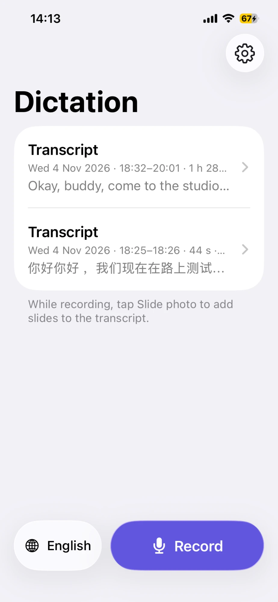
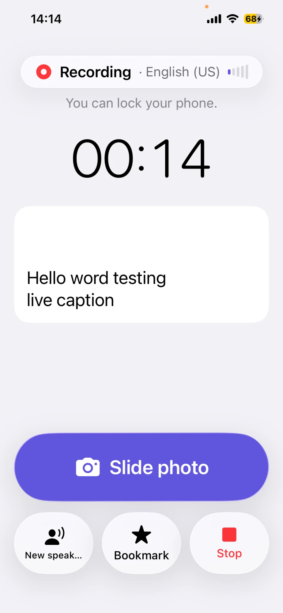
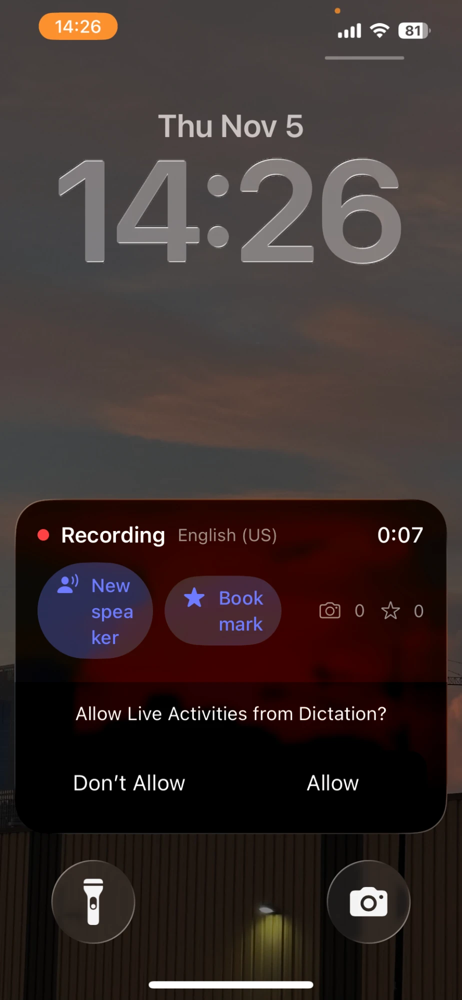
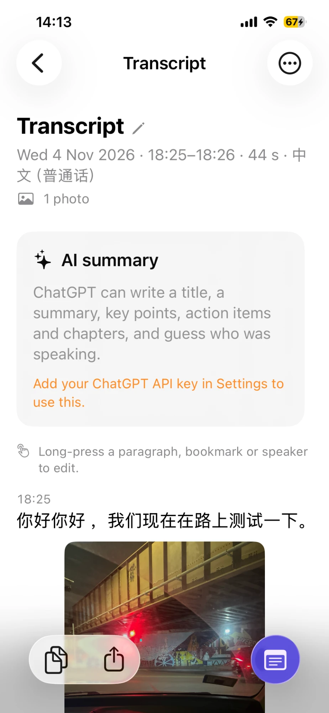

# Dictation

An iPhone app that live-captions the people talking in a room and keeps the
**whole transcript**, even for 2–3 hour talks. It saves as it goes, so
nothing needs copying out by hand.

| Home | Recording | Lock Screen | Transcript |
|:---:|:---:|:---:|:---:|
|  |  |  |  |

- On-device speech recognition (Apple SpeechAnalyzer, iOS 26), English or Chinese
- Keeps recording with the screen locked; resumes by itself after interruptions
  and marks any gap in the transcript
- Take photos of slides from inside the app; they appear in the transcript at
  the moment you took them
- "New speaker" and "Bookmark" buttons, paragraphs at pauses, timestamps
- Slide text is read from photos on the phone
- Edit a finished transcript: long-press a paragraph to edit or delete its
  text, or to add a bookmark or a new speaker there; long-press a bookmark or
  speaker marker to rename or delete it
- Copy, share, or send to Apple Notes through a Shortcut
- Optional: save the audio (off by default)
- AI summary: title, summary, key points, action items, chapters, guessed
  speakers and photo descriptions, in English, 中文 or both. Choose the AI in
  Settings: **ChatGPT** (default), Claude, Gemini, or **Qwen** (open-source,
  via OpenRouter). You need your own API key for the one you pick; only the
  recording you tap Generate on is sent.

| AI | Get a key | Default model |
|---|---|---|
| ChatGPT | platform.openai.com/api-keys | `gpt-6.1-sol` |
| Claude | platform.claude.com | `claude-opus-5-5` |
| Gemini | aistudio.google.com/apikey | `gemini-3.8-flash` |
| Qwen (OpenRouter) | openrouter.ai/keys | `qwen/qwen3.5-397b-a17b` |

See [docs/ROADMAP.md](docs/ROADMAP.md) for the plan and status.

## Build and install on your iPhone

You need a Mac with **Xcode 26 or later**, and an iPhone on **iOS 26 or later**.

**Intel Mac?** The App Store only offers the newest Xcode (27), which runs on
Apple silicon only. Download **Xcode 26.6** instead (needs macOS Tahoe 26.2 or
later): sign in at [developer.apple.com/download/all](https://developer.apple.com/download/all)
with your Apple ID, search "Xcode 26", download the `.xip`, double-click it and
drag Xcode into Applications. Xcode 26 installs on iPhones up to iOS 26; for an
iPhone on iOS 27, use the sideloading option below.

**No suitable Xcode?** Every CI run builds an installable app file: open the
repo's **Actions** tab → latest **CI** run → **Artifacts** →
*Dictation-unsigned-ipa*, and install it with a sideloading tool such as
Sideloadly using your Apple ID (with a free Apple ID it must be re-installed
every 7 days).

1. Install [Homebrew](https://brew.sh) if you don't have it, then XcodeGen:

   ```bash
   brew install xcodegen
   ```

2. Get the code:

   ```bash
   git clone https://github.com/siyu-li/Dictation-App.git
   cd Dictation-App
   ```

3. Set up signing once. Copy the example file and put your Apple team ID and a
   bundle prefix of your own in it (instructions are inside the file):

   ```bash
   cp Config/Local.xcconfig.example Config/Local.xcconfig
   ```

4. Generate the Xcode project and open it:

   ```bash
   xcodegen generate
   open Dictation.xcodeproj
   ```

5. Plug in your iPhone, choose it as the run destination, and press Run (⌘R).
   The first time:
   - On the iPhone, turn on **Settings → Privacy & Security → Developer Mode**.
   - If iOS says the developer isn't trusted: **Settings → General → VPN & Device
     Management** → your Apple ID → Trust.

With a free Apple account the app stops opening after 7 days; just press Run in
Xcode again. The $99/year Apple Developer Program makes installs last a year.

After pulling new changes, run `xcodegen generate` again before building.

## Download the app from GitHub Releases

Every release on the repository's **Releases** page has the app attached as
`Dictation-v<version>.ipa` (unsigned: install it with a sideloading tool such as
Sideloadly using your own Apple ID). To publish a new release, either:

- push a version tag:

  ```bash
  git tag v0.2.0 && git push origin v0.2.0
  ```

- or on GitHub open **Actions → CI → Run workflow**, pick the branch, type a
  version such as `0.2.0`, and press **Run workflow**. (GitHub shows this
  button only once the workflow is on the default branch, `main`.)

The build runs the tests, builds the app with that version number, and creates
the release with the IPA and auto-generated notes. Releases are public, like the
repository.

## Save to Apple Notes

Apps can't write into Apple Notes directly, so Dictation hands the transcript
to a Shortcut. Create it once:

1. Open the **Shortcuts** app → **+** (new shortcut). Name it exactly
   **Dictation to Notes** (or another name, and enter that name in
   Dictation's Settings).
2. Add the action **Get Dictation Transcript**. Tap its **Session ID** field and
   choose **Shortcut Input**.
3. Add the Notes action **Create Note**, with the body set to the result of
   *Get Dictation Transcript*. Pick a folder if you like.

Then in Dictation:

- Tap **Send to Notes** on a transcript; the Shortcut runs and creates the note.
  The first line of the transcript (its title) becomes the note's title.
- Or turn on **Send to Notes after stopping** in Settings to do it
  automatically each time you stop a recording.

Running the Shortcut by hand (without a Session ID) uses your most recent
finished recording. "Hey Siri, get transcript from Dictation" works too.

## Lock Screen controls

While recording, the Lock Screen shows the recording: Recording/Paused,
the elapsed time, the latest caption line, photo and bookmark counts, and
two buttons — **New speaker** and **Bookmark** — that work without
unlocking. Tap the banner to open the app (for example to take a slide
photo). It disappears as soon as you stop.

This comes from a small widget extension (`Widgets/`) that is part of the
app. Xcode signs it automatically with the same team as the app (its id is
`<your prefix>.dictation.widgets`). If the banner doesn't appear, check
**Settings → Dictation → Live Activities** on the iPhone.

## Project layout

```
App/                      iPhone app (SwiftUI)
  Engine/                 microphone + speech recognition
  Views/                  screens
  Camera/                 in-app camera
  Sharing/                export, Notes shortcut, photo import
  Intents/                Shortcuts actions
  LiveActivity/           keeps the Lock Screen display up to date
Shared/                   Live Activity data + Lock Screen button actions
                          (compiled into the app and the extension)
Widgets/                  Lock Screen (Live Activity) extension
Packages/TranscriptCore/  all app logic that doesn't need iOS: data model,
                          formatting, export, storage, recording coordinator
project.yml               XcodeGen spec for the Xcode project
.github/workflows/ci.yml  builds the app and runs tests on every push
```

`TranscriptCore` builds and tests anywhere Swift runs, including Linux:

```bash
swift test --package-path Packages/TranscriptCore
```

## Diagnostics

Settings → Diagnostics shows a log of what the app did (start/stop,
interruptions, errors). After testing on your phone, share that log so problems
can be fixed based on what really happened.
